# Tool Models

This document is written by `scraftcnc/tooling/tool_models.py`
(`python3 -m scraftcnc.tooling.tool_models`), from the code; do not
edit it.

Each model below can be made from a description of it, in any of three
forms, which all have the same keys: JSON on a command line, a Python
dictionary, or an entry in a tools file (`Shops.md`).  The letters on
the sketches mean the same size on every sketch.  The tables give no
values: read a catalog for those, or make them up.  The sketches are of
one sample, so their proportions are only a guide.

A size is a string with its unit (`"1/2 in"`, `"12.7 mm"`).  A length
takes `in`, `inch`, `inches`, `ft`, `mm`, `cm`.

The JSON and Python forms need a SolidCraft to talk to: a port number,
from `solidcraft --control 8080`, or `headless` for `solidcraft-cli`.
They add the model to the design at the origin, standing on its tip.
A description with a problem is refused before SolidCraft is touched:
the JSON form prints every problem and exits with 1, and the Python
form raises `SCShopError`.

## Contents

* [Python Interface](#python-interface)
* [End Mill](#end-mill)
* [Drill](#drill)
* [Chamfer Mill](#chamfer-mill)
* [Corner Rounding Mill](#corner-rounding-mill)
* [Double Angle Cutter](#double-angle-cutter)
* [Single End Countersink](#single-end-countersink)
* [Double End Countersink](#double-end-countersink)
* [Machine Vise](#machine-vise)
* [Jaw Plate](#jaw-plate)
* [Parallel](#parallel)
* [Grid Plate](#grid-plate)

## Python Interface

### `scraftcnc.tooling.cutter_models.model_description`

```python
scraftcnc.tooling.cutter_models.model_description(
    solidcraft: SCPyBind,
    description: dict[str, object],
    at: tuple[float, float, float] = (0.0, 0.0, 0.0),
    cache: SCModelCache | None = None,
) -> SCModeledTool
```

Model one tool from its description.

Arguments:
* `solidcraft` (`SCPyBind`): The SolidCraft session.
* `description` (`dict[str, object]`):
  The tool, with its `kind`, as `shops.check_tool()` takes it.  Its
  `name`, if any, names the body.
* `at` (`tuple[float, float, float]`):
  Where its tip goes (inches).
* `cache` (`SCModelCache | None`):
  Where to keep its body between runs, or `None` to build it.

Returns:
* (`SCModeledTool`): What was made, free to move.

Raises:
* `SCShopError`:
  If the description has any problem, before SolidCraft is touched.
* `SCSolidCraftError`: If SolidCraft refuses a command.
* `FileNotFoundError`: If no SolidCraft has the port.
* `ConnectionError`:
  If nothing listens on the port, or SolidCraft goes away.

### `scraftcnc.tooling.cutter_models.SCModeledTool`

```python
scraftcnc.tooling.cutter_models.SCModeledTool(
    body: str,
    sketch: str,
    occurrence: str,
)
```

A tool in SolidCraft: a component with its body and flute lines.

Attributes:
* `body` (`str`): Its body's name.
* `sketch` (`str`): The name of its flute lines' sketch.
* `occurrence` (`str`): Its component's occurrence, for moving it.

```python
SCModeledTool.items() -> list[str]
```

Return what `browser.visibility` shows or hides for the tool.

### `scraftcnc.shops.check_tool`

```python
scraftcnc.shops.check_tool(
    description: dict[str, object],
) -> tuple[str, dict[str, object]]
```

Check one tool's description, as for a model of it.

It takes the keys of its `kind` of tool (`Shops.md`), except that
`name` and `unique_id` get stand-ins, since a model does not need
them.

Arguments:
* `description` (`dict[str, object]`):
  The tool, with its `kind` (such as `"end_mill"`).

Returns:
* (`tuple[str, dict[str, object]]`):
  The list it goes in, in a tools file (a key of `CNC_KINDS`), and
  the tool, as `read()` gives it.

Raises:
* `SCShopError`: With every problem found.

### `scraftcnc.shops.SCShopError`

```python
scraftcnc.shops.SCShopError(problems: list[str])
```

The problems found in a shop description.

Attributes:
* `problems` (`list[str]`):
  Each problem, as `FILE:LINE: KEY: message`.

### `scraftcnc.pybind.scraftpybind.connect`

```python
scraftcnc.pybind.scraftpybind.connect(where: str) -> SCTransport
```

Return a transport for a port number, or for `headless`.

Arguments:
* `where` (`str`):
  A GUI's control port (e.g. `8080`), or `headless` for a session
  with no window.

Returns:
* (`SCTransport`): The transport, which connects on first use.

Raises:
* `ValueError`: If `where` is neither.

### `scraftcnc.pybind.scraftpybind.SCPyBind`

```python
scraftcnc.pybind.scraftpybind.SCPyBind(transport: SCTransport)
```

The top level of `scraftpybind`: SolidCraft's commands.

### `scraftcnc.pybind.scraftpybind.SCSolidCraftError`

```python
scraftcnc.pybind.scraftpybind.SCSolidCraftError(
    method: str,
    error: str,
    running: bool,
    busy: bool,
)
```

A SolidCraft request that failed.

Attributes:
* `method` (`str`): The request's method (e.g. `engine.execute`).
* `error` (`str`): The error text SolidCraft sent back.
* `running` (`bool`):
  True when the request timed out but is still running in the app;
  it has not failed, so it must not simply be sent again.
* `busy` (`bool`):
  True when the request was refused, without running, because an
  earlier request on this connection is still running.

## End Mill

An end mill: square, ball or bull nose (a square end with rounded
corners), and perhaps a rougher.

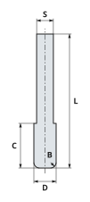

| Letter | Units  | Description                                               |
| ------ | ------ | --------------------------------------------------------- |
| `B`    | Length | `corner_radius`: Optional. A bull nose's corners.         |
| `C`    | Length | `length_of_cut`: How deep it can cut (LOC).               |
| `D`    | Length | `diameter`: The cutting diameter.                         |
| `L`    | Length | `overall_length`: Its whole length (OAL).                 |
| `S`    | Length | `shank`: Optional. The shank diameter, if not `diameter`. |

Other keys:

* `flutes` (integer): How many flutes.
* `end` (one of `square`, `ball`, `bull_nose`): The shape of its end.
* `material` (one of `HSS`, `cobalt`, `carbide`, `cermet`, `ceramic`,
  `CBN`, `PCD`, or another ending in `!`): What it is made of.
* `finish` (string): Its finish or coating (`uncoated`, `AlTiN`, ...).

JSON:

```
python3 -m scraftcnc.tooling.cutter_models 8080 '{
  "kind": "end_mill",
  "material": "carbide",
  "finish": "uncoated",
  "diameter": "1/2 in",
  "shank": "3/8 in",
  "length_of_cut": "1 in",
  "overall_length": "3 in",
  "flutes": 4,
  "end": "bull_nose",
  "corner_radius": "1/8 in"
}'
```

Python:

```python
from scraftcnc.pybind.scraftpybind import SCPyBind, connect
from scraftcnc.tooling.cutter_models import model_description

with connect("8080") as transport:
    model_description(
        SCPyBind(transport),
        {
            "kind": "end_mill",
            "material": "carbide",
            "finish": "uncoated",
            "diameter": "1/2 in",
            "shank": "3/8 in",
            "length_of_cut": "1 in",
            "overall_length": "3 in",
            "flutes": 4,
            "end": "bull_nose",
            "corner_radius": "1/8 in",
        },
    )
```

A tools file:

```toml
[[end_mills]]
name = "Sample end mill"
unique_id = 1
material = "carbide"
finish = "uncoated"
diameter = "1/2 in"
shank = "3/8 in"
length_of_cut = "1 in"
overall_length = "3 in"
flutes = 4
end = "bull_nose"
corner_radius = "1/8 in"
```

## Drill

A twist drill.

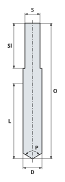

| Letter | Units  | Description                                               |
| ------ | ------ | --------------------------------------------------------- |
| `C`    | Length | `length_of_cut`: How deep it can cut (LOC).               |
| `D`    | Length | `diameter`: The cutting diameter.                         |
| `K`    | Length | `shank_length`: Optional. How far its shank comes down    |
|        |        | from its top; if not given, a `shank` starts where its    |
|        |        | flutes stop.                                              |
| `L`    | Length | `overall_length`: Its whole length (OAL).                 |
| `P`    | Angle  | `point_angle`: The included angle.                        |
| `S`    | Length | `shank`: Optional. The shank diameter, if not `diameter`. |

Other keys:

* `flutes` (integer): How many flutes (2 if not given).
* `material` (one of `HSS`, `cobalt`, `carbide`, `cermet`, `ceramic`,
  `CBN`, `PCD`, or another ending in `!`): What it is made of.
* `finish` (string): Its finish or coating (`uncoated`, `AlTiN`, ...).

JSON:

```
python3 -m scraftcnc.tooling.cutter_models 8080 '{
  "kind": "drill",
  "material": "HSS",
  "finish": "black oxide",
  "diameter": "5/8 in",
  "shank": "1/2 in",
  "shank_length": "1-1/2 in",
  "length_of_cut": "2-1/2 in",
  "overall_length": "4-1/2 in",
  "point_angle": "118 deg"
}'
```

Python:

```python
from scraftcnc.pybind.scraftpybind import SCPyBind, connect
from scraftcnc.tooling.cutter_models import model_description

with connect("8080") as transport:
    model_description(
        SCPyBind(transport),
        {
            "kind": "drill",
            "material": "HSS",
            "finish": "black oxide",
            "diameter": "5/8 in",
            "shank": "1/2 in",
            "shank_length": "1-1/2 in",
            "length_of_cut": "2-1/2 in",
            "overall_length": "4-1/2 in",
            "point_angle": "118 deg",
        },
    )
```

A tools file:

```toml
[[drills]]
name = "Sample drill"
unique_id = 1
material = "HSS"
finish = "black oxide"
diameter = "5/8 in"
shank = "1/2 in"
shank_length = "1-1/2 in"
length_of_cut = "2-1/2 in"
overall_length = "4-1/2 in"
point_angle = "118 deg"
```

## Chamfer Mill

A chamfer mill (a V-bit), which bevels top edges.

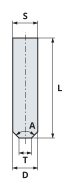

| Letter | Units  | Description                                               |
| ------ | ------ | --------------------------------------------------------- |
| `A`    | Angle  | `angle`: The included angle (90 deg makes 45 deg bevels). |
| `D`    | Length | `diameter`: The cutting diameter.                         |
| `L`    | Length | `overall_length`: Its whole length (OAL).                 |
| `S`    | Length | `shank`: Optional. The shank diameter, if not `diameter`. |
| `T`    | Length | `tip_diameter`: The diameter at its tip.                  |

Other keys:

* `flutes` (integer): How many flutes.
* `material` (one of `HSS`, `cobalt`, `carbide`, `cermet`, `ceramic`,
  `CBN`, `PCD`, or another ending in `!`): What it is made of.
* `finish` (string): Its finish or coating (`uncoated`, `AlTiN`, ...).

JSON:

```
python3 -m scraftcnc.tooling.cutter_models 8080 '{
  "kind": "chamfer_mill",
  "material": "carbide",
  "finish": "uncoated",
  "diameter": "1/2 in",
  "shank": "1/2 in",
  "tip_diameter": "1/4 in",
  "overall_length": "2 in",
  "angle": "90 deg"
}'
```

Python:

```python
from scraftcnc.pybind.scraftpybind import SCPyBind, connect
from scraftcnc.tooling.cutter_models import model_description

with connect("8080") as transport:
    model_description(
        SCPyBind(transport),
        {
            "kind": "chamfer_mill",
            "material": "carbide",
            "finish": "uncoated",
            "diameter": "1/2 in",
            "shank": "1/2 in",
            "tip_diameter": "1/4 in",
            "overall_length": "2 in",
            "angle": "90 deg",
        },
    )
```

A tools file:

```toml
[[chamfer_mills]]
name = "Sample chamfer mill"
unique_id = 1
material = "carbide"
finish = "uncoated"
diameter = "1/2 in"
shank = "1/2 in"
tip_diameter = "1/4 in"
overall_length = "2 in"
angle = "90 deg"
```

## Corner Rounding Mill

A corner rounding mill, which rounds top edges over to its radius.  Its
tip (a pilot) rides along the wall below.

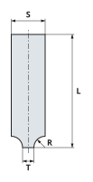

| Letter | Units  | Description                                               |
| ------ | ------ | --------------------------------------------------------- |
| `L`    | Length | `overall_length`: Its whole length (OAL).                 |
| `R`    | Length | `radius`: The radius it rounds edges to.                  |
| `S`    | Length | `shank`: Optional. The shank diameter, if not `diameter`. |
| `T`    | Length | `tip_diameter`: The diameter at its tip.                  |

Other keys:

* `flutes` (integer): How many flutes.
* `material` (one of `HSS`, `cobalt`, `carbide`, `cermet`, `ceramic`,
  `CBN`, `PCD`, or another ending in `!`): What it is made of.
* `finish` (string): Its finish or coating (`uncoated`, `AlTiN`, ...).

JSON:

```
python3 -m scraftcnc.tooling.cutter_models 8080 '{
  "kind": "corner_rounding_mill",
  "material": "carbide",
  "finish": "uncoated",
  "radius": "1/4 in",
  "tip_diameter": "1/4 in",
  "shank": "3/4 in",
  "overall_length": "2-1/2 in"
}'
```

Python:

```python
from scraftcnc.pybind.scraftpybind import SCPyBind, connect
from scraftcnc.tooling.cutter_models import model_description

with connect("8080") as transport:
    model_description(
        SCPyBind(transport),
        {
            "kind": "corner_rounding_mill",
            "material": "carbide",
            "finish": "uncoated",
            "radius": "1/4 in",
            "tip_diameter": "1/4 in",
            "shank": "3/4 in",
            "overall_length": "2-1/2 in",
        },
    )
```

A tools file:

```toml
[[corner_rounding_mills]]
name = "Sample corner rounding mill"
unique_id = 1
material = "carbide"
finish = "uncoated"
radius = "1/4 in"
tip_diameter = "1/4 in"
shank = "3/4 in"
overall_length = "2-1/2 in"
```

## Double Angle Cutter

A pointed double angle shank cutter: a cone above and a cone below its
widest point, on a thin neck, so it can chamfer bottom edges (back
chamfering) as well as top ones.

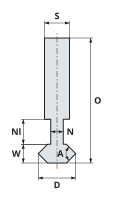

| Letter | Units  | Description                                               |
| ------ | ------ | --------------------------------------------------------- |
| `A`    | Angle  | `angle`: The included angle of the two cones together.    |
| `D`    | Length | `diameter`: The cutting diameter.                         |
| `L`    | Length | `overall_length`: Its whole length (OAL).                 |
| `M`    | Length | `neck_length`: Optional. The neck's length (L3), from the |
|        |        | shank to the cutter.                                      |
| `N`    | Length | `neck_diameter`: Optional. The neck's diameter.           |
| `S`    | Length | `shank`: Optional. The shank diameter, if not `diameter`. |
| `W`    | Length | `width`: The height of the cutter (L2), point to point.   |

Other keys:

* `flutes` (integer): How many flutes.
* `material` (one of `HSS`, `cobalt`, `carbide`, `cermet`, `ceramic`,
  `CBN`, `PCD`, or another ending in `!`): What it is made of.
* `finish` (string): Its finish or coating (`uncoated`, `AlTiN`, ...).

JSON:

```
python3 -m scraftcnc.tooling.cutter_models 8080 '{
  "kind": "double_angle_cutter",
  "material": "carbide",
  "finish": "uncoated",
  "diameter": "3/4 in",
  "shank": "1/2 in",
  "width": "3/8 in",
  "neck_diameter": "1/4 in",
  "neck_length": "1/2 in",
  "overall_length": "2-1/2 in",
  "angle": "90 deg"
}'
```

Python:

```python
from scraftcnc.pybind.scraftpybind import SCPyBind, connect
from scraftcnc.tooling.cutter_models import model_description

with connect("8080") as transport:
    model_description(
        SCPyBind(transport),
        {
            "kind": "double_angle_cutter",
            "material": "carbide",
            "finish": "uncoated",
            "diameter": "3/4 in",
            "shank": "1/2 in",
            "width": "3/8 in",
            "neck_diameter": "1/4 in",
            "neck_length": "1/2 in",
            "overall_length": "2-1/2 in",
            "angle": "90 deg",
        },
    )
```

A tools file:

```toml
[[double_angle_cutters]]
name = "Sample double angle cutter"
unique_id = 1
material = "carbide"
finish = "uncoated"
diameter = "3/4 in"
shank = "1/2 in"
width = "3/8 in"
neck_diameter = "1/4 in"
neck_length = "1/2 in"
overall_length = "2-1/2 in"
angle = "90 deg"
```

## Single End Countersink

A combined drill and countersink on a shank: a small drill at its tip,
joined to its body by a cone.  It can not go in a `tool_table` yet.

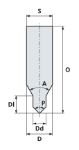

| Letter | Units  | Description                                               |
| ------ | ------ | --------------------------------------------------------- |
| `A`    | Angle  | `angle`: The countersink's included angle.                |
| `D`    | Length | `diameter`: The cutting diameter.                         |
| `E`    | Length | `drill_diameter`: The diameter of the small drill at its  |
|        |        | tip.                                                      |
| `G`    | Length | `drill_length`: Optional. How far the small drill reaches |
|        |        | from its tip (its diameter if not given).                 |
| `L`    | Length | `overall_length`: Its whole length (OAL).                 |
| `P`    | Angle  | `point_angle`: Optional. The included angle of the small  |
|        |        | drill's point (90 deg if not given).                      |
| `S`    | Length | `shank`: Optional. The shank diameter, if not `diameter`. |

Other keys:

* `flutes` (integer): How many flutes (2 if not given).
* `material` (one of `HSS`, `cobalt`, `carbide`, `cermet`, `ceramic`,
  `CBN`, `PCD`, or another ending in `!`): What it is made of.
* `finish` (string): Its finish or coating (`uncoated`, `AlTiN`, ...).

JSON:

```
python3 -m scraftcnc.tooling.cutter_models 8080 '{
  "kind": "single_countersink",
  "material": "HSS",
  "finish": "uncoated",
  "diameter": "3/4 in",
  "shank": "3/4 in",
  "drill_diameter": "3/8 in",
  "drill_length": "1/2 in",
  "overall_length": "2-1/2 in",
  "angle": "60 deg",
  "point_angle": "90 deg"
}'
```

Python:

```python
from scraftcnc.pybind.scraftpybind import SCPyBind, connect
from scraftcnc.tooling.cutter_models import model_description

with connect("8080") as transport:
    model_description(
        SCPyBind(transport),
        {
            "kind": "single_countersink",
            "material": "HSS",
            "finish": "uncoated",
            "diameter": "3/4 in",
            "shank": "3/4 in",
            "drill_diameter": "3/8 in",
            "drill_length": "1/2 in",
            "overall_length": "2-1/2 in",
            "angle": "60 deg",
            "point_angle": "90 deg",
        },
    )
```

A tools file:

```toml
[[single_countersinks]]
name = "Sample single end countersink"
unique_id = 1
material = "HSS"
finish = "uncoated"
diameter = "3/4 in"
shank = "3/4 in"
drill_diameter = "3/8 in"
drill_length = "1/2 in"
overall_length = "2-1/2 in"
angle = "60 deg"
point_angle = "90 deg"
```

## Double End Countersink

A combined drill and countersink, cut at both ends (a center drill).
Its `shank` means nothing, since it is cut at both ends.  It can not go
in a `tool_table` yet.

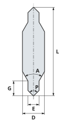

| Letter | Units  | Description                                               |
| ------ | ------ | --------------------------------------------------------- |
| `A`    | Angle  | `angle`: The countersink's included angle.                |
| `D`    | Length | `diameter`: The cutting diameter.                         |
| `E`    | Length | `drill_diameter`: The diameter of the small drill at its  |
|        |        | tip.                                                      |
| `G`    | Length | `drill_length`: Optional. How far the small drill reaches |
|        |        | from its tip (its diameter if not given).                 |
| `L`    | Length | `overall_length`: Its whole length (OAL).                 |
| `P`    | Angle  | `point_angle`: Optional. The included angle of the small  |
|        |        | drill's point (90 deg if not given).                      |

Other keys:

* `flutes` (integer): How many flutes (2 if not given).
* `material` (one of `HSS`, `cobalt`, `carbide`, `cermet`, `ceramic`,
  `CBN`, `PCD`, or another ending in `!`): What it is made of.
* `finish` (string): Its finish or coating (`uncoated`, `AlTiN`, ...).

JSON:

```
python3 -m scraftcnc.tooling.cutter_models 8080 '{
  "kind": "double_countersink",
  "material": "HSS",
  "finish": "uncoated",
  "diameter": "3/4 in",
  "drill_diameter": "3/8 in",
  "drill_length": "1/2 in",
  "overall_length": "3 in",
  "angle": "60 deg",
  "point_angle": "90 deg"
}'
```

Python:

```python
from scraftcnc.pybind.scraftpybind import SCPyBind, connect
from scraftcnc.tooling.cutter_models import model_description

with connect("8080") as transport:
    model_description(
        SCPyBind(transport),
        {
            "kind": "double_countersink",
            "material": "HSS",
            "finish": "uncoated",
            "diameter": "3/4 in",
            "drill_diameter": "3/8 in",
            "drill_length": "1/2 in",
            "overall_length": "3 in",
            "angle": "60 deg",
            "point_angle": "90 deg",
        },
    )
```

A tools file:

```toml
[[double_countersinks]]
name = "Sample double end countersink"
unique_id = 1
material = "HSS"
finish = "uncoated"
diameter = "3/4 in"
drill_diameter = "3/8 in"
drill_length = "1/2 in"
overall_length = "3 in"
angle = "60 deg"
point_angle = "90 deg"
```

## Machine Vise

A machine vise, of the kind that Kurt makes.

A picture rather than a true vise: enough to know what it is.  A real
Kurt is one casting; the model stacks it in layers, named from the
bottom up: the base, the body and the bed.  On the bed sit the fixed jaw
and the movable jaw, each with a jaw plate on its clamping face.

The base and the body are blocks, stacked and centered on one another.
They have notches in both sides that line up, for hold downs: the body's
are bigger, so that a box wrench fits around the nut.  The bed is two
rails that run the whole length, with an end block between them at each
end.  Under the opening that leaves, the body has a pocket down to the
base, where the lead screw shows.

The lead screw is a cylinder along X, from the pocket's -X end out
through a hole in the body's +X end, ending in an extruded hexagon.

The jaws sit on the bed: the fixed jaw at the -X end, away from the
hexagon, and the movable jaw opening toward +X.  Under the movable jaw,
a slider fits between the rails and reaches down through the pocket,
with a hole that the lead screw goes through.  It starts at the jaw's
clamping face and is shorter than the jaw by an end block's length, so
that the jaw reaches the bed's +X end as the slider meets the end block.
The jaw plates do the actual clamping; each has two holes for the screws
that hold it on.

All lengths are in millimeters.

The sketches are of `tools.KURT_D688`, opened as far as it goes.
Hidden edges are dashed.  Its jaw plates are separate parts,
described in [Jaw Plate](#jaw-plate).

Top:

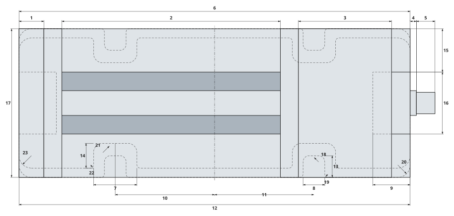

Back (the hexagon's end):

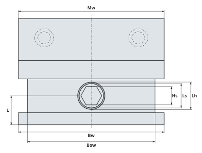

Side (from -Y):

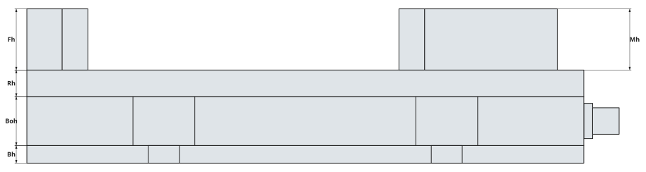

| Number | Units   | Description                                              |
| ------ | ------- | -------------------------------------------------------- |
| 1      | Length  | `fixed_jaw.length`: The jaw that stays put: its size     |
|        |         | along X, the lead screw's direction.                     |
| 2      | Length  | `max_opening`: The largest gap between the jaw plates.   |
| 3      | Length  | `movable_jaw.length`: The jaw that the lead screw moves: |
|        |         | its size along X, the lead screw's direction.            |
| 4      | Length  | `lead_screw_stick_out`: How far the lead screw's         |
|        |         | cylinder reaches past the body's +X end.                 |
| 5      | Length  | `hex_length`: The hexagon's size along X.                |
| 6      | Length  | `base.length`: The bottom layer: its size along X, the   |
|        |         | lead screw's direction.                                  |
| 7      | Length  | `body_notches.width`: The notches in the body, at the    |
|        |         | same places but bigger: a notch's size along X.          |
| 8      | Length  | `base_notches.width`: The notches in the base: a notch's |
|        |         | size along X.                                            |
| 9      | Length  | `end_block_length`: An end block's size along X.         |
| 10     | Lengths | `body_notches.centers`: The notches in the body, at the  |
|        |         | same places but bigger: the X of each notch's center     |
|        |         | (X1, X2, ...), from the block's center, from most        |
|        |         | negative up. Empty, the sides are plain.                 |
| 11     | Lengths | `base_notches.centers`: The notches in the base: the X   |
|        |         | of each notch's center (X1, X2, ...), from the block's   |
|        |         | center, from most negative up. Empty, the sides are      |
|        |         | plain.                                                   |
| 12     | Length  | `body.length`: The layer on the base: its size along X,  |
|        |         | the lead screw's direction.                              |
| 13     | Length  | `base_notches.depth`: The notches in the base: how far a |
|        |         | notch reaches in from the side.                          |
| 14     | Length  | `body_notches.depth`: The notches in the body, at the    |
|        |         | same places but bigger: how far a notch reaches in from  |
|        |         | the side.                                                |
| 15     | Length  | `rail_width`: A bed rail's size along Y.                 |
| 16     | Length  | `rail_gap`: The distance between the rails.              |
| 17     | Length  | `fixed_jaw.width`: The jaw that stays put: its size      |
|        |         | along Y.                                                 |
| 18     | Length  | `base_notches.inner_radius`: The notches in the base:    |
|        |         | the radius of its two corners farthest in.               |
| 19     | Length  | `base_notches.outer_radius`: The notches in the base:    |
|        |         | the radius of its two corners where it meets the side.   |
| 20     | Length  | `base.corner_radius`: The bottom layer: the radius of    |
|        |         | its four corners.                                        |
| 21     | Length  | `body_notches.inner_radius`: The notches in the body, at |
|        |         | the same places but bigger: the radius of its two        |
|        |         | corners farthest in.                                     |
| 22     | Length  | `body_notches.outer_radius`: The notches in the body, at |
|        |         | the same places but bigger: the radius of its two        |
|        |         | corners where it meets the side.                         |
| 23     | Length  | `body.corner_radius`: The layer on the base: the radius  |
|        |         | of its four corners.                                     |
| 24     | Length  | `movable_jaw.width`: The jaw that the lead screw moves:  |
|        |         | its size along Y.                                        |
| 25     | Length  | `base.width`: The bottom layer: its size along Y.        |
| 26     | Length  | `body.width`: The layer on the base: its size along Y.   |
| 27     | Length  | `lead_screw_height`: The height of the lead screw's axis |
|        |         | above the base's bottom.                                 |
| 28     | Length  | `hex_size`: The size across the flats of the hexagon on  |
|        |         | the lead screw's end.                                    |
| 29     | Length  | `lead_screw_diameter`: The lead screw's diameter.        |
| 30     | Length  | `lead_screw_hole_diameter`: The diameter of the hole for |
|        |         | the lead screw in the body's end.                        |
| 31     | Length  | `base.height`: The bottom layer: its size along Z.       |
| 32     | Length  | `body.height`: The layer on the base: its size along Z.  |
| 33     | Length  | `rail_height`: The height of the bed: its rails and end  |
|        |         | blocks.                                                  |
| 34     | Length  | `fixed_jaw.height`: The jaw that stays put: its size     |
|        |         | along Z.                                                 |
| 35     | Length  | `movable_jaw.height`: The jaw that the lead screw moves: |
|        |         | its size along Z.                                        |

Not drawn (square on the sample): `fixed_jaw.corner_radius`,
`movable_jaw.corner_radius`.

A machine vise has no tools file entry yet, so it is made in
Python, in millimeters, like `tools.KURT_D688`:

```python
from scraftcnc.pybind.scraftpybind import SCPyBind, connect
from scraftcnc.tooling.tools import KURT_D688

with connect("8080") as transport:
    KURT_D688.model(SCPyBind(transport), opening=76.2)
```

A setup file (`examples/setup/`) names one by its `type`:

```json
{
  "kind": "machine_vise",
  "type": "Kurt D688",
  "opening": "6 in",
  "location": [
    "0 in",
    "-3.15 in"
  ],
  "height": "0 in",
  "orientation": "-90 deg"
}
```

### `scraftcnc.tooling.tools.SCMachineVise`

```python
scraftcnc.tooling.tools.SCMachineVise(
    name: str,
    base: SCViseBlock,
    body: SCViseBlock,
    base_notches: SCViseNotches,
    body_notches: SCViseNotches,
    rail_width: float,
    rail_height: float,
    rail_gap: float,
    end_block_length: float,
    fixed_jaw: SCViseBlock,
    movable_jaw: SCViseBlock,
    jaw_plate: SCJawPlate,
    max_opening: float,
    lead_screw_diameter: float,
    lead_screw_stick_out: float,
    lead_screw_height: float,
    lead_screw_hole_diameter: float,
    hex_size: float,
    hex_length: float,
)
```

A machine vise, of the kind that Kurt makes.

A picture rather than a true vise: enough to know what it is.  A real
Kurt is one casting; the model stacks it in layers, named from the
bottom up: the base, the body and the bed.  On the bed sit the fixed
jaw and the movable jaw, each with a jaw plate on its clamping face.

The base and the body are blocks, stacked and centered on one
another.  They have notches in both sides that line up, for hold
downs: the body's are bigger, so that a box wrench fits around the
nut.  The bed is two rails that run the whole length, with an end
block between them at each end.  Under the opening that leaves, the
body has a pocket down to the base, where the lead screw shows.

The lead screw is a cylinder along X, from the pocket's -X end out
through a hole in the body's +X end, ending in an extruded hexagon.

The jaws sit on the bed: the fixed jaw at the -X end, away from the
hexagon, and the movable jaw opening toward +X.  Under the movable
jaw, a slider fits between the rails and reaches down through the
pocket, with a hole that the lead screw goes through.  It starts at
the jaw's clamping face and is shorter than the jaw by an end block's
length, so that the jaw reaches the bed's +X end as the slider meets
the end block.  The jaw plates do the actual clamping; each has two
holes for the screws that hold it on.

All lengths are in millimeters.

Attributes:
* `name` (`str`): What it is.
* `base` (`SCViseBlock`): The bottom layer.
* `body` (`SCViseBlock`): The layer on the base.
* `base_notches` (`SCViseNotches`): The notches in the base.
* `body_notches` (`SCViseNotches`):
  The notches in the body, at the same places but bigger.
* `rail_width` (`float`): A bed rail's size along Y.
* `rail_height` (`float`): The height of the bed: its rails and end
  blocks.
* `rail_gap` (`float`): The distance between the rails.
* `end_block_length` (`float`): An end block's size along X.
* `fixed_jaw` (`SCViseBlock`): The jaw that stays put.
* `movable_jaw` (`SCViseBlock`): The jaw that the lead screw moves.
* `jaw_plate` (`SCJawPlate`): The jaw plate on each jaw.
* `max_opening` (`float`): The largest gap between the jaw plates.
* `lead_screw_diameter` (`float`): The lead screw's diameter.
* `lead_screw_stick_out` (`float`):
  How far the lead screw's cylinder reaches past the body's +X end.
* `lead_screw_height` (`float`):
  The height of the lead screw's axis above the base's bottom.
* `lead_screw_hole_diameter` (`float`):
  The diameter of the hole for the lead screw in the body's end.
* `hex_size` (`float`):
  The size across the flats of the hexagon on the lead screw's end.
* `hex_length` (`float`): The hexagon's size along X.

```python
SCMachineVise.bed_top() -> float
```

Return the height of the top of the bed, above the base's bottom.

```python
SCMachineVise.overall_length() -> float
```

Return the vise's length, out to the end of the hexagon.

```python
SCMachineVise.opening_length() -> float
```

Return the length of the opening between the end blocks.

```python
SCMachineVise.slider() -> SCViseBlock
```

Return the block under the movable jaw, between the rails.

```python
SCMachineVise.slider_volume() -> float
```

Return the volume the slider's model should have.

```python
SCMachineVise.jaw_plate_volume() -> float
```

Return the volume a jaw plate's model should have.

```python
SCMachineVise.movable_face(opening: float) -> float
```

Return the X of the movable jaw's clamping face, behind its plate.

```python
SCMachineVise.gap_center(opening: float) -> float
```

Return the X of the middle of the gap between the jaw plates.

```python
SCMachineVise.hexagon() -> list[tuple[float, float]]
```

Return the corners of the lead screw's hexagon, flats up and down.

```python
SCMachineVise.body_volume() -> float
```

Return the volume the body's model should have.

```python
SCMachineVise.lead_screw_volume() -> float
```

Return the volume the lead screw's model should have.

```python
SCMachineVise.keep_out(
    center: Point = (0.0, 0.0, 0.0),
    opening: float = 0.0,
    margin: str = VISE_MARGIN,
) -> SCKeepOut
```

Return the regions around the vise that a tool must not enter.

```python
SCMachineVise.model(
    solidcraft: SCPyBind,
    center: Point = (0.0, 0.0, 0.0),
    opening: float = 0.0,
    lift: float = 0.0,
) -> list[str]
```

Model the vise, up from the center of the base's bottom face.

```python
SCMachineVise.cacheable(opening: float) -> tuple[SCCacheable, ...]
```

Return the vise as models that can be cached.

### `scraftcnc.tooling.tools.SCViseBlock`

```python
scraftcnc.tooling.tools.SCViseBlock(
    length: float,
    width: float,
    height: float,
    corner_radius: float,
)
```

A block of a vise: a layer of its base, or a jaw.

Its outline is a rectangle with rounded corners, and perhaps notches
in its sides, extruded straight up.  All lengths are in millimeters.

Attributes:
* `length` (`float`): Its size along X, the lead screw's direction.
* `width` (`float`): Its size along Y.
* `height` (`float`): Its size along Z.
* `corner_radius` (`float`): The radius of its four corners.

```python
SCViseBlock.outline(
    name: str,
    center: tuple[float, float] = (0.0, 0.0),
    notches: SCViseNotches | None = None,
) -> SCRoundedPolygon
```

Return the block's outline, as seen from above.

```python
SCViseBlock.volume(notches: SCViseNotches | None = None) -> float
```

Return the volume the model should have.

```python
SCViseBlock.model(
    solidcraft: SCPyBind,
    name: str,
    center: Point = (0.0, 0.0, 0.0),
    notches: SCViseNotches | None = None,
) -> str
```

Model the block, up from the center of its bottom face.

### `scraftcnc.tooling.tools.SCViseNotches`

```python
scraftcnc.tooling.tools.SCViseNotches(
    centers: tuple[float, ...],
    width: float,
    depth: float,
    inner_radius: float,
    outer_radius: float,
)
```

The notches in both sides of one layer of a vise's base.

Each side has one rectangular notch per center, so the notches on
the two sides line up.  All four of a notch's corners are rounded.
All lengths are in millimeters.

Attributes:
* `centers` (`tuple[float, ...]`):
  The X of each notch's center (X1, X2, ...), from the block's
  center, from most negative up.  Empty, the sides are plain.
* `width` (`float`): A notch's size along X.
* `depth` (`float`): How far a notch reaches in from the side.
* `inner_radius` (`float`): The radius of its two corners farthest in.
* `outer_radius` (`float`):
  The radius of its two corners where it meets the side.

```python
SCViseNotches.side_corners(edge_y: float, direction: int) -> list[SCCorner]
```

Return the corners of the notches along one side of a block.

```python
SCViseNotches.area() -> float
```

Return the area that all of the notches remove from a block.

## Jaw Plate

A jaw plate: the replaceable part of a vise's jaw that clamps.

A machine vise's jaw plates are separate parts, each held to its jaw by
two socket head cap screws.  Each screw goes through a counterbore in
the clamping face, so that its head sits below the face.  The hole
patterns are standard enough that plates from one maker fit another's
vises: a 6 in vise has holes on 3.875 in centers, for 1/2-13 screws.

The plate is a block: `length` is its thickness, from its clamping face
back to its jaw; `width` runs across the vise, and `height` up. All
lengths are in millimeters.

The sketches are of `tools.KURT_JAW_PLATE`, the plate on
`tools.KURT_D688`.  Hidden edges are dashed.

Top (clamping face down):

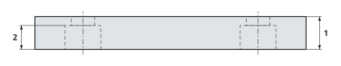

Clamping face:

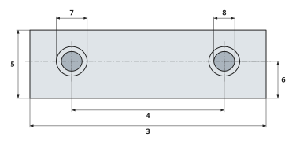

| Number | Units  | Description                                               |
| ------ | ------ | --------------------------------------------------------- |
| 1      | Length | `length`: Its thickness, from its clamping face back.     |
| 2      | Length | `counterbore_depth`: How deep the counterbores reach in   |
|        |        | from the clamping face.                                   |
| 3      | Length | `width`: Its size across the vise.                        |
| 4      | Length | `hole_spacing`: The distance between its two holes.       |
| 5      | Length | `height`: Its size up.                                    |
| 6      | Length | `hole_height`: The height of its holes' centers above its |
|        |        | bottom.                                                   |
| 7      | Length | `counterbore_diameter`: The diameter of the counterbores, |
|        |        | for the screws' heads.                                    |
| 8      | Length | `hole_diameter`: The diameter of its holes.               |

Not a size:

* `screw`: The screws that hold it on (e.g. `1/2-13 SHCS`).

Like the vise, it is made in Python, in millimeters:

```python
from scraftcnc.pybind.scraftpybind import SCPyBind, connect
from scraftcnc.tooling.tools import KURT_JAW_PLATE

with connect("8080") as transport:
    KURT_JAW_PLATE.model(SCPyBind(transport), "Jaw plate")
```

### `scraftcnc.tooling.tools.SCJawPlate`

```python
scraftcnc.tooling.tools.SCJawPlate(
    screw: str,
    length: float,
    width: float,
    height: float,
    hole_spacing: float,
    hole_diameter: float,
    hole_height: float,
    counterbore_diameter: float,
    counterbore_depth: float,
)
```

A jaw plate: the replaceable part of a vise's jaw that clamps.

A machine vise's jaw plates are separate parts, each held to its jaw
by two socket head cap screws.  Each screw goes through a counterbore
in the clamping face, so that its head sits below the face.  The
hole patterns are standard enough that plates from one maker fit
another's vises: a 6 in vise has holes on 3.875 in centers, for
1/2-13 screws.

The plate is a block: `length` is its thickness, from its clamping
face back to its jaw; `width` runs across the vise, and `height` up.
All lengths are in millimeters.

Attributes:
* `screw` (`str`): The screws that hold it on (e.g. `1/2-13 SHCS`).
* `length` (`float`): Its thickness, from its clamping face back.
* `width` (`float`): Its size across the vise.
* `height` (`float`): Its size up.
* `hole_spacing` (`float`): The distance between its two holes.
* `hole_diameter` (`float`): The diameter of its holes.
* `hole_height` (`float`):
  The height of its holes' centers above its bottom.
* `counterbore_diameter` (`float`):
  The diameter of the counterbores, for the screws' heads.
* `counterbore_depth` (`float`):
  How deep the counterbores reach in from the clamping face.

```python
SCJawPlate.block() -> SCViseBlock
```

Return the plate without its holes.

```python
SCJawPlate.volume() -> float
```

Return the volume its model should have.

```python
SCJawPlate.model(
    solidcraft: SCPyBind,
    name: str,
    center: Point = (0.0, 0.0, 0.0),
    facing: float = 1.0,
) -> str
```

Model the plate, with its holes and counterbores.

## Parallel

A parallel: a thin steel bar that work sits on in a vise.

Parallels come in matched pairs, one under each side of the work. Most
have two round holes through them, which make them lighter and easier to
pick up; the holes are optional.

It stands on edge, with its length along Y, the way it lies along the
jaws of a vise whose lead screw runs along X.  Its holes go through it
along X, halfway up, the same distance either side of its middle.  All
lengths are in millimeters.

The sketches are of `Parallel 3/4 in A`, from `tools.PARALLELS`.
Hidden edges are dashed.

Side:

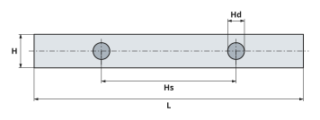

End:

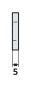

| Number | Units  | Description                                               |
| ------ | ------ | --------------------------------------------------------- |
| 1      | Length | `length`: Its size along Y.                               |
| 2      | Length | `hole_spacing`: Optional. The distance between its two    |
|        |        | holes' centers; 0 for no holes.                           |
| 3      | Length | `height`: Its size along Z.                               |
| 4      | Length | `hole_diameter`: Optional. The diameter of its holes; 0   |
|        |        | for no holes.                                             |
| 5      | Length | `thickness`: Its size along X.                            |

`tools.PARALLELS` is a set of two of each of the standard imperial
heights, in inches: 1/2, 5/8, 3/4, 7/8, 1, 1-1/8, 1-1/4, 1-3/8, 1-1/2,
1-5/8.  Each is 1/8 in thick and 6 in long, with two holes 3 in apart,
half as wide as the parallel is tall.  Each is named for its height and
A or B (`Parallel 3/4 in A`).

It is made in Python, in millimeters:

```python
from scraftcnc.pybind.scraftpybind import SCPyBind, connect
from scraftcnc.tooling.tools import SCParallel

# Its sizes in millimeters; the holes are optional.
parallel = SCParallel(
    "Parallel 3/4 in",
    height=19.050,
    thickness=3.175,
    length=152.4,
    hole_spacing=76.2,
    hole_diameter=9.525,
)
with connect("8080") as transport:
    parallel.model(SCPyBind(transport), (0.0, 0.0, 0.0))
```

A setup file (`examples/setup/`) names one of the set by its
`type`:

```json
{
  "kind": "parallel",
  "type": "Parallel 1-1/2 in A",
  "location": [
    "0 in",
    "2.9375 in"
  ],
  "height": "2.64 in",
  "orientation": "-90 deg"
}
```

### `scraftcnc.tooling.tools.SCParallel`

```python
scraftcnc.tooling.tools.SCParallel(
    name: str,
    height: float,
    thickness: float,
    length: float,
    hole_spacing: float,
    hole_diameter: float,
)
```

A parallel: a thin steel bar that work sits on in a vise.

Parallels come in matched pairs, one under each side of the work.
Most have two round holes through them, which make them lighter and
easier to pick up; the holes are optional.

It stands on edge, with its length along Y, the way it lies along
the jaws of a vise whose lead screw runs along X.  Its holes go
through it along X, halfway up, the same distance either side of its
middle.  All lengths are in millimeters.

Attributes:
* `name` (`str`): What it is.
* `height` (`float`): Its size along Z.
* `thickness` (`float`): Its size along X.
* `length` (`float`): Its size along Y.
* `hole_spacing` (`float`):
  Optional.  The distance between its two holes' centers; 0 for no
  holes.
* `hole_diameter` (`float`):
  Optional.  The diameter of its holes; 0 for no holes.

```python
SCParallel.has_holes() -> bool
```

Return True if the parallel has holes.

```python
SCParallel.volume() -> float
```

Return the volume its model should have.

```python
SCParallel.block() -> SCViseBlock
```

Return the parallel's shape.

```python
SCParallel.prism(center: Point) -> SCPrism
```

Return the rectangular prism that just encloses the parallel.

```python
SCParallel.model(solidcraft: SCPyBind, center: Point) -> str
```

Model the parallel, up from the center of its bottom edge.

## Grid Plate

A grid plate: a plate with a grid of holes, for holding work down.

The grid has the same pitch along X and Y, and fills the plate, with its
outer holes `edge` in from all four sides.  Each hole's top edge may be
chamfered at 45 degrees.

It may also have tooling holes, in an even number of rows and columns,
centered on the plate, each one dead center between four of the grid's
holes.  They come in two sizes, a tap drill for a thread and a close fit
for the same screw, in a checkerboard: a tooling hole's neighbors along
X and Y are the other size.  With them, grid plates are easy to make in
pairs in a home shop, and pairs of them hold many parts made at the same
time.

Its outline is an `SCRoundedPolygon` with its four corners rounded and
all of the holes inside, so that one extrude makes the plate; one
chamfer command then does every chamfer.  All lengths are in
millimeters.

Chamfers take a lot of computing, once.  `GRID_PLATE`'s 200 took
SolidCraft about 4-1/2 minutes, keeping four processors busy, against 2
seconds without them.  The model cache (`model_cache.py`, which
`setups.py` and `show_demo.py` use) keeps the plate as a STEP file in
`~/.scraftcnc/tool_cache/`, which loads in about a second, so the cost
comes again only when the plate's numbers change, or `tools.py`,
`mount.py` or `geometry.py` does.  `model()` called directly does not
use the cache.

The sketches are of `tools.GRID_PLATE`.  Its tap drill tooling
holes are filled, and its close fit ones open.

Top:

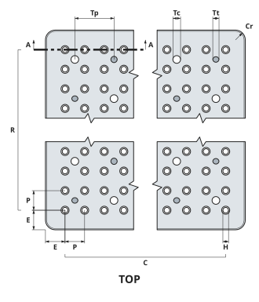

Section through a grid hole (8 times size):

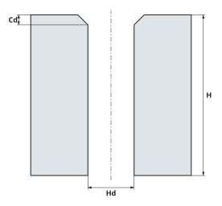

| Number | Units  | Description                                               |
| ------ | ------ | --------------------------------------------------------- |
| 1      | Length | `edge`: The distance from a side to the nearest holes.    |
| 2      | Length | `pitch`: The distance between grid holes, along X and Y.  |
| 3      | Length | `length`: Its size along X.                               |
| 4      | Length | `width`: Its size along Y.                                |
| 5      | Length | `corner_radius`: Optional. The radius of its corners.     |
| 6      | Length | `tooling_pitch`: Optional. The distance between tooling   |
|        |        | holes, along X and Y.                                     |
| 7      | Length | `tap_diameter`: Optional. The diameter of the tooling     |
|        |        | holes to be threaded (the tap drill).                     |
| 8      | Length | `close_diameter`: Optional. The diameter of the close fit |
|        |        | tooling holes.                                            |
| 9      | Length | `height`: Its size along Z, its thickness.                |
| 10     | Length | `hole_diameter`: The diameter of the grid's holes.        |
| 11     | Length | `chamfer_depth`: Optional. How deep the 45 degree chamfer |
|        |        | on each grid hole's top edge is; 0 for none. Slow to      |
|        |        | model the first time (above).                             |

Not a size:

* `name`: What it is.
* `tooling_columns`: Optional.  The number of columns of tooling holes,
  an even number; 0 for none.
* `tooling_rows`: Optional.  The number of rows of tooling holes, an
  even number; 0 for none.

A shop describes its grid plates in a tooling file (`Shops.md`),
as `examples/shop/tooling.toml` describes `tools.GRID_PLATE`:

```toml
[[grid_plates]]
name = "Grid plate"
description = "Aluminum, made in the shop, with tooling holes for #10-32"
length = "5-1/2 in"
width = "10-1/2 in"
height = "1/2 in"
pitch = "1/2 in"
edge = "1/2 in"
hole_diameter = "0.144 in"
corner_radius = "1/4 in"
chamfer_depth = "1/32 in"
tooling_columns = 2
tooling_rows = 4
tooling_pitch = "3 in"
tap_diameter = "0.159 in"
close_diameter = "0.196 in"
```

Or it is made in Python, in millimeters:

```python
from scraftcnc.model_cache import SCModelCache
from scraftcnc.pybind.scraftpybind import SCPyBind, connect
from scraftcnc.tooling.tools import GRID_PLATE

# Through the cache: slow the first time, then about a second.
with connect("8080") as transport:
    (plate,) = GRID_PLATE.cacheable()
    SCModelCache().insert(SCPyBind(transport), plate)
```

A setup file (`examples/setup/`) names one by its `type`, from
the shop's tooling files or `tools.py`:

```json
{
  "kind": "grid_plate",
  "type": "Grid plate",
  "location": [
    "2 in",
    "1-1/2 in"
  ],
  "height": "-1 in",
  "orientation": "90 deg"
}
```

### `scraftcnc.tooling.tools.SCGridPlate`

```python
scraftcnc.tooling.tools.SCGridPlate(
    name: str,
    length: float,
    width: float,
    height: float,
    pitch: float,
    edge: float,
    hole_diameter: float,
    corner_radius: float,
    chamfer_depth: float,
    tooling_columns: int,
    tooling_rows: int,
    tooling_pitch: float,
    tap_diameter: float,
    close_diameter: float,
)
```

A grid plate: a plate with a grid of holes, for holding work down.

The grid has the same pitch along X and Y, and fills the plate, with
its outer holes `edge` in from all four sides.  Each hole's top edge
may be chamfered at 45 degrees.

It may also have tooling holes, in an even number of rows and
columns, centered on the plate, each one dead center between four of
the grid's holes.  They come in two sizes, a tap drill for a thread
and a close fit for the same screw, in a checkerboard: a tooling
hole's neighbors along X and Y are the other size.  With them, grid
plates are easy to make in pairs in a home shop, and pairs of them
hold many parts made at the same time.

Its outline is an `SCRoundedPolygon` with its four corners rounded
and all of the holes inside, so that one extrude makes the plate;
one chamfer command then does every chamfer.  All lengths are in
millimeters.

Chamfers take a lot of computing, once.  `GRID_PLATE`'s 200 took
SolidCraft about 4-1/2 minutes, keeping four processors busy,
against 2 seconds without them.  The model cache (`model_cache.py`,
which `setups.py` and `show_demo.py` use) keeps the plate as a STEP
file in `~/.scraftcnc/tool_cache/`, which loads in about a second,
so the cost comes again only when the plate's numbers change, or
`tools.py`, `mount.py` or `geometry.py` does.  `model()` called
directly does not use the cache.

Attributes:
* `name` (`str`): What it is.
* `length` (`float`): Its size along X.
* `width` (`float`): Its size along Y.
* `height` (`float`): Its size along Z, its thickness.
* `pitch` (`float`): The distance between grid holes, along X and Y.
* `edge` (`float`): The distance from a side to the nearest holes.
* `hole_diameter` (`float`): The diameter of the grid's holes.
* `corner_radius` (`float`): Optional.  The radius of its corners.
* `chamfer_depth` (`float`):
  Optional.  How deep the 45 degree chamfer on each grid hole's top
  edge is; 0 for none.  Slow to model the first time (above).
* `tooling_columns` (`int`):
  Optional.  The number of columns of tooling holes, an even number;
  0 for none.
* `tooling_rows` (`int`):
  Optional.  The number of rows of tooling holes, an even number; 0
  for none.
* `tooling_pitch` (`float`):
  Optional.  The distance between tooling holes, along X and Y.
* `tap_diameter` (`float`):
  Optional.  The diameter of the tooling holes to be threaded (the
  tap drill).
* `close_diameter` (`float`):
  Optional.  The diameter of the close fit tooling holes.

```python
SCGridPlate.from_shop(plate: dict[str, object]) -> 'SCGridPlate'
```

Return a grid plate described in a shop's tooling file.

```python
SCGridPlate.chamfered_diameter() -> float
```

Return the diameter of a grid hole at the plate's top.

```python
SCGridPlate.hole_centers() -> list[tuple[float, float]]
```

Return where the grid's holes are, from the plate's center.

```python
SCGridPlate.tooling_holes() -> list[tuple[float, float, float]]
```

Return where the tooling holes are, and their sizes.

```python
SCGridPlate.volume() -> float
```

Return the volume the model should have.

```python
SCGridPlate.seat() -> Point
```

Return the middle of the plate's top.

```python
SCGridPlate.outline(center: tuple[float, float]) -> SCRoundedPolygon
```

Return the plate's outline and holes, as seen from above.

```python
SCGridPlate.model(solidcraft: SCPyBind, center: Point) -> list[str]
```

Model the plate, up from the center of its bottom face.

```python
SCGridPlate.cacheable() -> tuple[SCCacheable, ...]
```

Return the plate as a model that can be cached.

```python
SCGridPlate.prism(center: Point) -> SCPrism
```

Return the rectangular prism that just encloses the plate.

```python
SCGridPlate.keep_out(center: Point) -> SCKeepOut
```

Return the prism around the plate.
